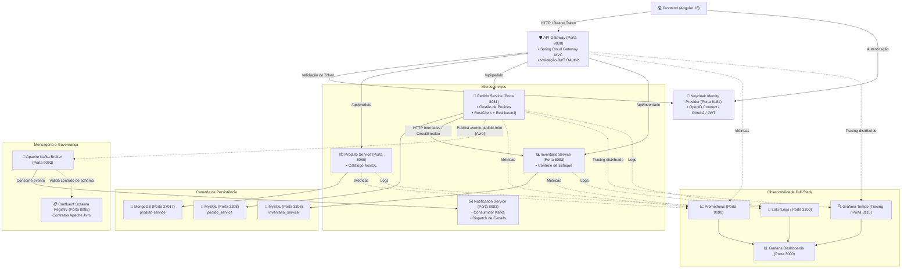

# ⚡ PulseCommerce - Plataforma de E-Commerce Distribuída & Event-Driven

[](https://www.oracle.com/java/)
[](https://spring.io/projects/spring-boot)
[](https://kafka.apache.org/)
[](https://resilience4j.readme.io/)
[](https://www.keycloak.org/)
[](https://testcontainers.com/)

Plataforma de comércio eletrônico desenvolvida sob os padrões modernos de **Arquitetura de Microsserviços**, **Orientação a Eventos (EDA)**, **Observabilidade Integral** e **Resiliência em Sistemas Distribuídos**.

---

## 🏛️ Visão Geral da Arquitetura



---

## 🛠️ Stack Tecnológica & Decisões Arquiteturais

| Componente | Tecnologia | Decisão & Justificativa Técnica |
| :--- | :--- | :--- |
| **Linguagem & Framework** | Java 17 / Spring Boot 3.5 | Versões estáveis e modernas; aproveitamento de Records, Virtual Threads ready e novos padrões do Spring 6. |
| **API Gateway** | Spring Cloud Gateway Server WebMvc | Ponto único de entrada, roteamento reativo, agregação de Swagger OpenAPI e aplicação de filtros de segurança. |
| **Segurança Centralizada** | Keycloak (OAuth2 / OIDC) | Autenticação *stateless* desacoplada dos serviços com tokens JWT assinados criptograficamente. |
| **Mensageria Assíncrona** | Apache Kafka | Desacoplamento temporal e resiliência no processamento de notificações de compra pós-pedido. |
| **Governança de Contratos** | Confluent Schema Registry + Apache Avro | Validação estrita e compatibilidade de schemas binários, evitando quebras entre produtores e consumidores. |
| **Comunicação Síncrona** | Spring `RestClient` + HTTP Interfaces | Nova abordagem nativa do Spring 6 (`@GetExchange`, `@PutExchange`), substituindo o legado OpenFeign com menor sobrecarga. |
| **Tolerância a Falhas** | Resilience4j | Circuit Breaker, Retries exponenciais e Fallbacks para isolar falhas de serviços dependentes. |
| **Bancos de Dados Poliglotas** | MySQL 8.4 (Flyway) & MongoDB 8.0 | MySQL para consistência relacional e transacional (pedidos/estoque) e MongoDB para flexibilidade de documentos no catálogo. |
| **Observabilidade Completa** | Prometheus, Grafana, Loki & Tempo | Pilha corporativa para telemetria (Métricas, Logs e Tracing distribuído ponta a ponta com traceId). |
| **Testes de Integração** | Testcontainers, WireMock & RestAssured | Testes automatizados executados contra containers reais de banco e mensageria, dispensando mocks frágeis. |
| **Frontend** | Angular 18 + Tailwind CSS | Interface moderna com componentes standalone e integração direta com o fluxo de autenticação do Keycloak. |

---

## ⚙️ Microsserviços do Ecossistema

### 1. `api-gateway` (Porta `9000`)
* Roteador de tráfego unificado.
* Validação de autenticação via Keycloak Resource Server.
* Agregação unificada de todas as especificações OpenAPI/Swagger (`/swagger-ui.html`).
* Fallback global para serviços temporariamente indisponíveis.

### 2. `produto-service` (Porta `8080`)
* Gerencia o catálogo de produtos com persistência em MongoDB.
* Endpoints REST para criação, consulta, atualização e exclusão de itens.

### 3. `pedido-service` (Porta `8081`)
* Orquestrador de pedidos com persistência MySQL via migrações Flyway.
* Comunicação com o `inventario-service` via cliente HTTP declarativo com tolerância a falhas.
* Publicação do evento `pedido-feito` no Apache Kafka serializado via Avro.

### 4. `inventario-service` (Porta `8082`)
* Controle de saldo em tempo real por SKU.
* Validação de disponibilidade e operações atômicas de decremento de estoque.

### 5. `notification-service` (Porta `8083`)
* Consumidor Kafka reativo ao tópico de pedidos.
* Deserialização tipada via Schema Registry e disparo de e-mails transacionais (configurável via Mailtrap/SMTP).

### 6. `microservices-frontend` (Porta `4200`)
* Interface web SPA Angular com login corporativo, painel de produtos e gestão de estoque.

---

## 🧪 Estratégia de Testes Automatizados

O ecossistema adota a pirâmide de testes com forte ênfase em **testes de integração reais**:
* **Testcontainers:** Inicialização dinâmica de instâncias de `MySQLContainer`, `MongoDBContainer` e `KafkaContainer` gerenciadas pelo ciclo de vida do JUnit 5 (`@ServiceConnection`).
* **WireMock:** Simulação determinística de respostas HTTP e cenários de timeout/erro em chamadas inter-serviços.
* **RestAssured:** Validação e2e de status code, contrato JSON e cabeçalhos de resposta HTTP.

Para rodar os testes:
```bash
# Exemplo no pedido-service
mvn test -f pedido-service/pom.xml
```

---

## 🚀 Como Executar o Projeto Localmente

### Pré-requisitos
* [Docker](https://www.docker.com/) & Docker Compose instalados
* [Java 17+](https://adoptium.net/) e [Maven 3.9+](https://maven.apache.org/)
* [Node.js 18+](https://nodejs.org/) & Angular CLI (para o frontend)

### 1. Subir a Infraestrutura com Docker Compose
Na raiz do repositório, execute:
```bash
docker compose up -d
```
Isso inicializará automaticamente:
* Bancos de dados: MySQL Inventário (`3306`), MySQL Pedidos (`3308`), MongoDB (`27017`);
* Mensageria: Zookeeper (`2181`), Kafka Broker (`9092`), Schema Registry (`8085`), Kafka UI (`8086`);
* Segurança: Keycloak (`8181`) com o realm pré-configurado;
* Observabilidade: Prometheus (`9090`), Grafana (`3000`), Tempo (`3110`), Loki (`3100`).

### 2. Iniciar os Microsserviços
Em terminais separados (ou via IDE), execute:
```bash
mvn spring-boot:run -f api-gateway/pom.xml
mvn spring-boot:run -f produto-service/pom.xml
mvn spring-boot:run -f inventario-service/pom.xml
mvn spring-boot:run -f pedido-service/pom.xml
mvn spring-boot:run -f notification-service/pom.xml
```

### 3. Iniciar o Frontend
```bash
cd microservices-frontend
npm install
ng serve
```

---

## 📊 Portais e Dashboards Disponíveis

| Serviço | URL | Descrição |
| :--- | :--- | :--- |
| **Frontend Web** | [http://localhost:4200](http://localhost:4200) | Interface do Usuário |
| **Swagger UI Centralizado** | [http://localhost:9000/swagger-ui.html](http://localhost:9000/swagger-ui.html) | Documentação de APIs via Gateway |
| **Keycloak Admin** | [http://localhost:8181](http://localhost:8181) | Gestão de Usuários e Tokens (admin/admin) |
| **Kafka UI** | [http://localhost:8086](http://localhost:8086) | Monitoramento de Tópicos e Mensagens Kafka |
| **Grafana** | [http://localhost:3000](http://localhost:3000) | Dashboards de Métricas, Logs e Traces |
| **Prometheus** | [http://localhost:9090](http://localhost:9090) | Coleta de Métricas Actuator |

---

## 🔮 Discussão Arquitetural: Transações Distribuídas

No fluxo de checkout distribuído (`pedido-service` ➔ `inventario-service` ➔ `kafka`), a plataforma adota o desacoplamento assíncrono. Em ambientes corporativos de alta criticidade sob concorrência extrema, a consistência eventual e a idempotência podem ser garantidas através de:
1. **Transactional Outbox Pattern**: Garantir atomicidade entre a gravação do pedido e o envio do evento para o Kafka, evitando o problema de *Dual Write*.
2. **Saga Pattern (Coreografada ou Orquestrada)**: Transações compensatórias para estorno de estoque caso o processamento de pagamento ou notificação encontre falhas irrecuperáveis.

